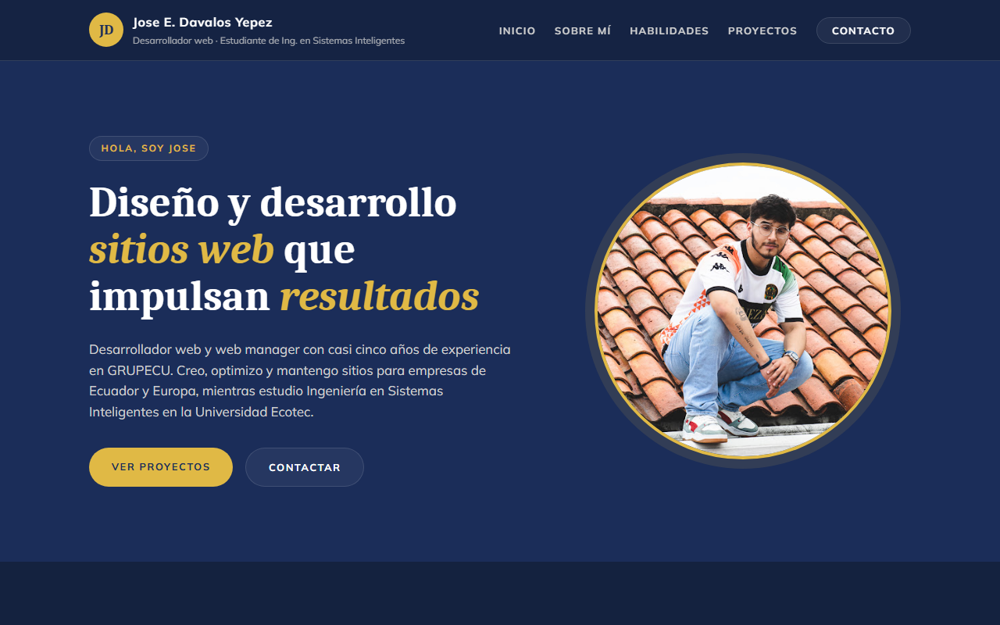

# Portafolio Personal

**Autor:** Jose E. Davalos Yepez
**Asignatura:** Programación de Sistemas Web — Universidad Ecotec
**Actividad:** Actividad Integradora 1 — Desarrollo de un portafolio personal

## Descripción

Sitio web personal que presenta mi perfil como desarrollador web y estudiante de
Ingeniería en Sistemas Inteligentes. Incluye las secciones:

- **Inicio:** presentación con título, descripción y fotografía.
- **Sobre mí:** quién soy, mis intereses y objetivos profesionales.
- **Habilidades:** seis áreas técnicas que domino.
- **Proyectos:** sitios reales en los que he trabajado como desarrollador, diseñador y responsable de mantenimiento.
- **Contacto:** formulario visual con nombre, correo y mensaje.

El diseño se basa en la identidad visual de GRUPECU (azul marino y dorado, tipografías Caladea y Mulish).

## Tecnologías utilizadas

- HTML5 (etiquetas semánticas: `header`, `nav`, `main`, `section`, `article`, `footer`)
- CSS3 (variables en `:root`, Flexbox, pseudoclase `:hover`, transiciones y media queries)
- Google Fonts
- Git y GitHub

## Estructura del proyecto

```
portafolio-personal/
├── index.html
├── styles.css
├── README.md
└── img/
```

## Cómo visualizar el proyecto

1. Clonar o descargar el repositorio:
   ```
   git clone https://github.com/jedy-knight11/portafolio-personal.git
   ```
2. Abrir el archivo `index.html` en cualquier navegador.

También se puede ver publicado en GitHub Pages:
https://jedy-knight11.github.io/portafolio-personal/

## Captura de pantalla


